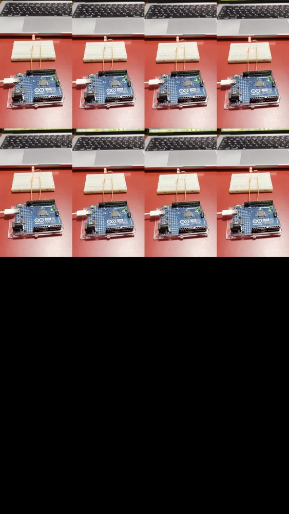

# Experiment 07 — PWM LED Brightness and Average Voltage

**Date:** 2026-10-12  
**Status:** Completed (visible fading and two DC-voltage readings)

## Objective

Use the Arduino UNO R4 Minima's PWM output to vary the brightness of an LED, then check whether a multimeter's DC reading scales with the programmed PWM duty cycle.

## Reference / theory

Pulse-width modulation (PWM) rapidly alternates an output between LOW and HIGH. Changing the fraction of time spent HIGH changes the average voltage, without generating a continuously adjustable analog voltage. For a HIGH level approximately equal to the supply voltage:

\[
D \approx \frac{n}{255}, \qquad V_{\mathrm{avg}} \approx V_{\mathrm{HIGH}}D
\]

Here, \(n\) is the `analogWrite()` setting under the default 8-bit resolution. The formula is an **approximate model**; the actual waveform and voltmeter response were not characterized with an oscilloscope.

## Equipment

- Arduino UNO R4 Minima, programmed using Arduino IDE on a Mac
- External red LED and nominal **1 kΩ** current-limiting resistor
- EIC-801 solderless breadboard and jumper wires
- MAS-838 digital multimeter set to **DC voltage, 20 V range**

## Circuit

```text
Arduino D9 (PWM) --- node A --- [1 kΩ] --- LED anode (+)
                                              LED cathode (-) --- Arduino GND

Voltmeter red (+): node A, breadboard row 10
Voltmeter black (-): Arduino GND, breadboard row 16
```

D9 was used instead of D8 because **D9 supports PWM on UNO R4 Minima**. The LED's polarity and series resistor were preserved from the earlier blinking experiment. The voltmeter measured the PWM output node relative to ground, **not the voltage across the LED**.

## Predictions

The theoretical estimates discussed before the measurements assumed \(V_{\mathrm{HIGH}}\approx4.90\ \mathrm V\). That value was used as an **assumption**, not a fresh simultaneous measurement of D9's actual HIGH level.

| `analogWrite(9, n)` | Nominal duty | Predicted average voltage, assuming 4.90 V HIGH |
| --- | ---: | ---: |
| `n = 128` | 128/255 ≈ 50.2% | **2.46 V** |
| `n = 64` | 64/255 ≈ 25.1% | **1.23 V** |

## Measurements

| Test | Prediction | Observed | Instrument / method |
| --- | ---: | ---: | --- |
| LED brightness sweep (0 → 255 → 0) | Brightness gradually changes | Gradual visible fading observed | Visual/video observation |
| PWM setting 128 | ≈ 2.46 V average | **2.40 V** | MAS-838, DC 20 V, D9-to-GND |
| PWM setting 64 | ≈ 1.23 V average | **1.20 V** | MAS-838, DC 20 V, D9-to-GND |

The measured reading halved from 2.40 V to 1.20 V when the PWM command was halved from 128 to 64. Differences from the estimates were **0.06 V** and **0.03 V**, respectively. These figures are comparisons with an assumed supply value and are not a calibrated PWM-output accuracy specification.

## Arduino code

- [07-pwm-fade.ino](../sketches/07-pwm-fade/07-pwm-fade.ino): ramps duty value from 0 to 255 and back, using 10 ms delays.
- [07-pwm-voltage-test.ino](../sketches/07-pwm-voltage-test/07-pwm-voltage-test.ino): holds `analogWrite(9, 128)` steady. The setting was then changed to `64` and the code uploaded again for the second measurement.

**Key functions and statements:** `pinMode(9, OUTPUT)` configures D9; `analogWrite(9, n)` sets PWM duty; `for` loops change the duty step-by-step; `delay(10)` determines the approximate speed of fading.

## Photos



## Analysis

The observed DC reading was proportional to the PWM command within the limited two-point test. This is consistent with a DC multimeter responding approximately to the signal's average voltage. **It does not mean D9 continuously output 2.40 V or 1.20 V.** The waveform was not directly inspected, and the multimeter's detailed averaging behavior was not tested.

## Mistakes, safety, and next improvements

- The LED required its 1 kΩ resistor for current limiting.
- Never use the multimeter's current-input jacks across the voltage output; this test uses **voltage measurement**.
- To improve the result, record the actual D9 HIGH-level voltage, several duty-cycle settings, and (if available later) the waveform on an oscilloscope.
- Next: apply timed control signals to a servo motor, noting that hobby-servo control pulses are **not the same as PWM LED dimming**.
