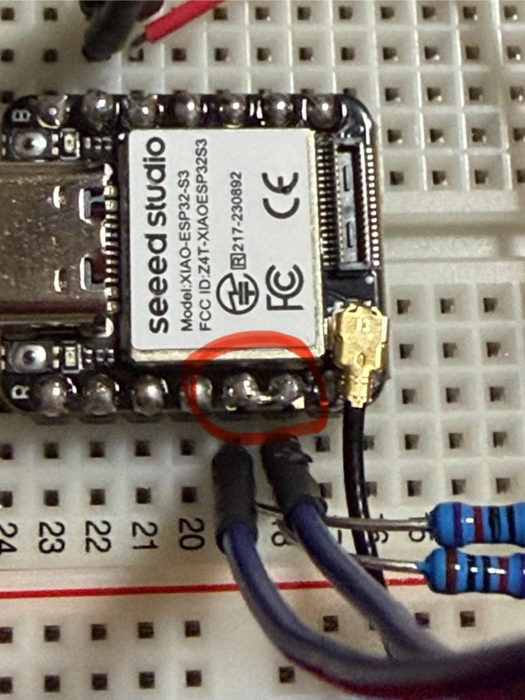

# Experiment 12 — Six-Axis IMU Acceleration and Angular-Rate Measurements

**Date:** 2026-10-19  
**Status:** Completed — I²C device identity and all six sensor channels read successfully

## Objective

Connect Akizuki's AE-LSM6DSV16X to the XIAO ESP32S3 Sense using I²C, identify the sensor, then acquire three-axis acceleration and three-axis angular-rate data.

## Reference / theory

At rest, the accelerometer's specific-force magnitude is expected to be near local gravitational acceleration (about 9.81 m/s²), distributed across the axes according to orientation. The gyroscope reports angular rate in degrees per second; bias or noise can produce nonzero readings when still. I²C requires a separate SDA data line and SCL clock line with suitable pull-ups.

The device ID register **WHO_AM_I (0x0F)** read **0x70**, matching LSM6DSV16X. The sketch multiplied raw acceleration by 0.00059820565 m/s² per count and angular rate by 0.00875 degrees/s per count, under its configured full-scale assumptions; these coefficients were used in code, not calibrated experimentally.

## Equipment

- Seeed Studio XIAO ESP32S3 Sense, USB-powered, Arduino IDE 2.3.10, ESP32 board package
- Akizuki AE-LSM6DSV16X six-axis IMU (LSM6DSV16X)
- EIC-801 breadboard and jumper wires
- Two nominal 10 kΩ I²C pull-up resistors
- MAS-838 multimeter in continuity mode for wiring investigation

## Circuit

~~~text
XIAO 3V3 ------------ IMU 3V3
XIAO GND ------------ IMU GND
XIAO D4 / GPIO5 ----- IMU SDA ---- [10 kΩ] ---- XIAO 3V3
XIAO D5 / GPIO6 ----- IMU SCL ---- [10 kΩ] ---- XIAO 3V3
XIAO GND ------------ IMU SA0 (address selection: 0x6A)
~~~

IMU address/pull-up solder jumpers were not modified; the setup used external wires and resistors.

## Experimental procedure

1. Connect the IMU to XIAO 3V3, GND, D4/SDA, and D5/SCL, with the external pull-ups and SA0 tied to GND for address `0x6A`.
2. Attempt I²C discovery and record the initial no-device/timeout failures.
3. Power down and investigate the SDA and SCL paths with continuity testing and a close-up photograph.
4. Remove the unintended solder connection between the adjacent D4 and D5 header pads.
5. With power still removed, confirm that D4-to-D5 continuity is no longer detected and that each pin still connects to its intended pad.
6. Power the circuit, scan address `0x6A`, read `WHO_AM_I`, configure the IMU, and acquire acceleration and angular-rate samples.

## Predictions

- The selected sensor should ACK at 0x6A and WHO_AM_I should be 0x70.
- An inactive 0x6B address may return a normal NACK rather than identifying another device.
- For a stationary sensor, \(\lVert \mathbf{a}\rVert=\sqrt{a_x^2+a_y^2+a_z^2}\) [m/s²] should be near 9.81 m/s².
- Gyroscope samples should change with rotation and need not show exactly zero at rest.

## Measurements and observations

| Check | Prediction | Observation | Instrument / context |
| --- | --- | --- | --- |
| Earlier SDA/SCL idle readings | Typically HIGH | **1 / 1** | MCU digital-input test; alone does not prove bus operation |
| Earlier I²C attempts | Valid ACK | **No device / timeout (Error 5)** | ESP-IDF and Arduino attempts |
| After solder repair, address 0x6A | ACK | **DETECTED!** | Arduino serial scanner |
| WHO_AM_I register | 0x70 | **0x70** | I²C register read |
| Unselected 0x6B address | No ACK | **Error 2** | Arduino serial scanner |
| Three-axis acceleration | Readable data | **Three samples below** | Arduino converted output |
| Three-axis angular rate | Readable data | **Three samples below** | Arduino converted output |

### Preserved six-axis readings

| Sample | ax (m/s²) | ay (m/s²) | az (m/s²) | gx (°/s) | gy (°/s) | gz (°/s) |
| --- | ---: | ---: | ---: | ---: | ---: | ---: |
| 1 | -1.50 | -6.37 | 7.08 | 2.30 | 1.37 | -2.01 |
| 2 | -1.61 | -6.43 | 7.14 | 0.43 | 1.27 | -1.17 |
| 3 | -1.73 | -6.45 | 7.13 | -1.24 | -1.99 | 2.51 |

**Calculated from the rounded readings above (not newly measured):** accelerometer magnitudes approximately **9.64, 9.74, 9.77 m/s²**.

## Arduino code

[12-imu-readout.ino](../sketches/12-imu-readout/12-imu-readout.ino) — transcribed from the code used in the working conversation, not independently extracted from Arduino's local project file.

## Photos

## Troubleshooting: unintended D4/D5 solder bridge

The original I²C attempts failed in both ESP-IDF and Arduino tests: no device was discovered, and timeout **Error 5** was observed. A digital-input check showed SDA and SCL idle readings of **1 / 1**, but that result only showed logic-high levels and did not prove that the two lines were electrically independent.

With power removed, continuity testing detected a conductive path between XIAO D4/GPIO5 and D5/GPIO6. The close-up photograph showed solder joining the adjacent header region. The solder was separated, after which the continuity buzzer no longer indicated D4-to-D5 continuity. The individual pins still connected to their respective pads.

After the repair, the IMU acknowledged at **I²C address `0x6A`**, `WHO_AM_I` returned **`0x70`**, and all three acceleration axes and all three gyroscope axes produced data. Address `0x6B` returned **Error 2**, consistent with the unselected address not acknowledging.

| Classification | Statement |
| --- | --- |
| Confirmed observation | D4-to-D5 continuity was detected before the solder repair. |
| Confirmed observation | D4-to-D5 continuity was no longer detected after the solder was separated. |
| Confirmed observation | I²C discovery, device identity, acceleration, and gyroscope reads succeeded after the repair. |
| Supported inference | The unintended solder bridge created an electrical short between SDA and SCL and was a primary cause of the earlier communication failures. |
| Not established | The available record does not prove that the bridge was the only defect in every earlier wiring attempt. |

## Analysis

The before/after electrical tests and successful I²C communication strongly support the solder bridge as a primary cause of the failure, while stopping short of claiming a complete causal reconstruction of every earlier attempt.

The calculated acceleration magnitudes are close to expected gravity. This is a sanity check rather than a calibrated accuracy assessment; the gyroscope values contain possible motion and bias.

## Lessons learned

- Logic-high idle readings alone do not prove that SDA and SCL are isolated or that an I²C bus is functioning.
- Continuity checks, close-up inspection, address scanning, and identity-register reads provide complementary evidence.
- A successful device ID should be followed by physically plausible sensor readings rather than treated as the end of validation.

## Safety

- Power down before continuity measurements and solder repair; do not assume two adjacent signal pads are independent merely because individual pin paths have continuity.
- Avoid connecting 5 V to XIAO 3.3 V sensor lines.

## Next steps

- Preserve raw register data and perform accelerometer and gyroscope bias calibration.
- Record stationary data over a longer interval to characterize noise and drift.
- Continue to [Experiment 13](13-oled-i2c-display.md) and display information over the repaired I²C bus.
