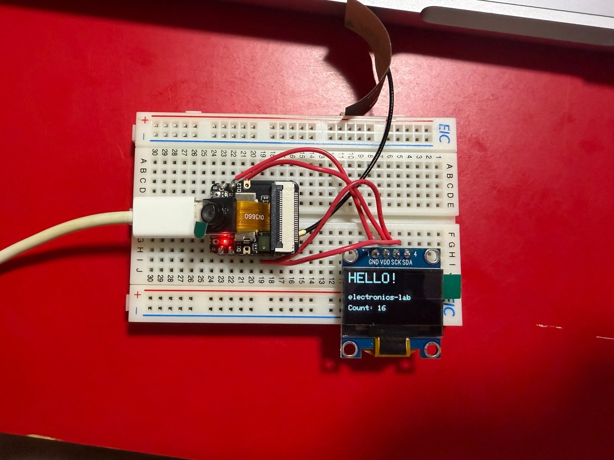

# Experiment 13 — OLED Display and I²C Communication

**Date:** 2026-10-19  
**Status:** Completed — visible text and updating counter confirmed

## Objective

Use the XIAO ESP32S3 Sense to control a nominal 0.96-inch 128×64 monochrome OLED display via I²C.

## Reference / theory

I²C shares data on SDA and a clock on SCL. This OLED board labels its I²C clock pin **SCK**; in this setup SCK connects to the XIAO's SCL. The application updates the display framebuffer and then transmits it to the display controller.

## Equipment

- XIAO ESP32S3 Sense, USB powered
- Akizuki monochrome OLED module, order code 112031
- Breadboard, jumper leads, I²C pull-up arrangement from earlier experiments
- Arduino IDE, Adafruit GFX and Adafruit SSD1306 libraries

## Circuit

~~~text
XIAO 3V3 ------------ OLED VDD
XIAO GND ------------ OLED GND
XIAO D4 / GPIO5 ----- OLED SDA
XIAO D5 / GPIO6 ----- OLED SCK (I²C clock)
~~~

The IMU was disconnected for this initial display demonstration. The test reused the external SDA/SCL pull-up approach; effective total resistance during this run was not measured.

## Experimental procedure

1. Disconnect the IMU and connect the OLED to XIAO 3V3, GND, D4/SDA, and D5/SCL.
2. Start I²C at 100 kHz and probe the two expected OLED addresses, `0x3C` and `0x3D`.
3. Initialize the SSD1306-compatible display at the address that acknowledges.
4. Draw `HELLO!`, `electronics-lab`, and an incrementing counter in the display buffer.
5. Transfer the buffer to the OLED once per second and visually confirm the output.

## Predictions

The sketch searches addresses 0x3C and 0x3D, initializes the SSD1306-compatible interface, draws a greeting and increments a software counter every second. The actual selected address was not copied to the preserved observations.

## Measurements and observations

| Check | Expected | Observation | Context |
| --- | --- | --- | --- |
| Greeting | HELLO! | **HELLO!** visible | Bench photograph |
| Project label | electronics-lab | **electronics-lab** visible | Bench photograph |
| Program counter | Increment on refresh | **Count: 16** visible in photograph | One captured instant; no separate timing calibration |
| I²C address | Detect 0x3C or 0x3D | OLED visibly worked, **exact address not archived** | No serial address log preserved |

## Arduino code

[13-oled-display.ino](../sketches/13-oled-display/13-oled-display.ino) — transcribed from the successful session.

## Photos

## Troubleshooting

The OLED had failed during earlier I²C attempts made before the D4/D5 solder repair described in Experiment 12. After the bridge was removed, the display initialized and showed the intended text. This sequence supports the shared SDA/SCL short as a likely cause of the earlier OLED failure, but it does not prove that every detail of the earlier OLED wiring was correct.

The exact responding address was not copied from the serial output, so the report records only that the tested sketch found either `0x3C` or `0x3D`. It does not guess which one responded.

## Analysis

The OLED showed the intended text after the solder bridge between XIAO D4 and D5 had been repaired for Experiment 12. The shared previous I²C failure is therefore plausibly explained by the same short, without proving that every earlier OLED wiring detail was correct.

## Lessons learned

- The module's SCK label is used as the I²C clock line here, not a separate SPI experiment.
- Visible application output verifies more than an address ACK alone, but the detected address should still be preserved.
- A shared bus fault can prevent multiple otherwise unrelated peripherals from working.

## Next steps

- Retain the detected I²C address and serial initialization log in future tests.
- Use the verified 3.3 V supply and recheck wiring with power removed.
- Combine OLED output with live sensor readings after completing [Experiment 14](14-imu-tilt-servo.md).
