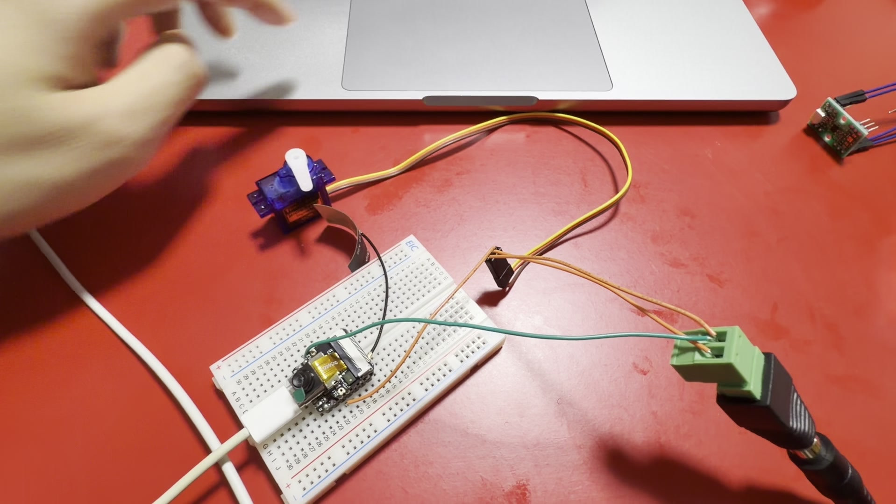

# Experiment 15 — ESP32-S3 Wi-Fi and Bluetooth Low Energy

**Date:** 2026-10-19 to 2026-10-22 (the first scanning observations were recorded on 2026-10-19; subsequent network and BLE tests were completed by 2026-10-22)

**Status:** Completed — Wi-Fi discovery, network communication, browser-controlled actuation, and BLE GATT interaction were demonstrated

## Objective

Demonstrate wireless communication on the Seeed Studio XIAO ESP32S3 Sense, distinguishing Wi-Fi scanning from actual IP communication and BLE advertising from GATT data exchange. Use a Mac to control an SG90 servo over a wireless network and read/write a BLE characteristic.

## Reference and theory

Wi-Fi scanning detects advertised networks. Successful scanning by itself does not demonstrate association, an assigned IP address, or application data exchange. A local HTTP server can receive commands over TCP/IP after a network connection is established. BLE uses advertising for discovery and GATT services/characteristics for structured reads and writes. BLE discovery alone does not demonstrate data transfer.

The servo test commanded positions of 30°, 90°, and 150°. These are software command angles; shaft positions were not independently measured.

## Equipment and tools

- Seeed Studio XIAO ESP32S3 Sense and external Wi-Fi antenna
- Mac computer and USB connection
- SG90 servo and appropriate power wiring with a shared control-signal reference
- Arduino IDE, a Wi-Fi scan program, an HTTP control program, and a BLE server program
- Chrome or another local browser; LightBlue BLE application on the Mac

Exact historical Arduino sketches for this series have not been recovered in the provided handoff. Do not reconstruct them and label them as the originally tested source.

## Wiring and network configuration

The initial Wi-Fi scan used the USB-powered XIAO and external antenna, without the servo. In the later HTTP control experiment, the ESP32 and SG90 were wired so the controller could transmit servo control pulses while the servo was independently powered; see the earlier SG90 and common-ground documentation for the wiring principle.

A temporary local Wi-Fi address of `192.168.11.19` was observed during a successful network-associated session. It is **not a static or guaranteed address**. The public report intentionally omits the private network's SSID and password.

Bluetooth device name observed: `electronics-lab-BLE`. Service UUID and characteristic UUID were not preserved and are not guessed.

## Procedure and observed results

| Stage | Expected outcome | Observed result | Evidence and limits |
| --- | --- | --- | --- |
| Initial Wi-Fi scan | Nearby SSIDs may be found | **0 networks found** | External antenna was not attached |
| Wi-Fi scan with antenna | Discover nearby access points | **11 SSIDs discovered** | Serial output from the earlier experiment |
| Wi-Fi association | Join local network | **Succeeded** | Session account; access-point details withheld |
| IP addressing | Receive local IP | **192.168.11.19 observed** | One session; not a reserved address |
| HTTP servo control | Trigger SG90 from Mac browser | **Servo moved in response** | 30°, 90°, and 150° commands issued; mechanical angles unmeasured |
| BLE advertising and discovery | Mac finds ESP32 BLE server | **Succeeded** | Device appeared as `electronics-lab-BLE` in LightBlue |
| GATT service/characteristic interaction | Access characteristic | **Read and Write succeeded** | Exact service and characteristic UUIDs not retained |
| BLE Write reception | Receive data on ESP32 | **`Hello ESP32` appeared in serial output** | Actual retained serial text below |

### Preserved BLE console output

```text
Starting BLE...
BLE advertising started!
Received: Hello ESP32
```

These outputs demonstrate advertising and incoming data reception, but do not establish every possible BLE connection/reconnection behavior or long-duration stability.

## Visual evidence



This frame illustrates a single-servo bench setup. **The frame does not independently demonstrate Wi-Fi, HTTP traffic, BLE connections, or commanded shaft angles.** The source video was reviewed as supplemental evidence and is not published in this repository.

## Troubleshooting

The first Wi-Fi scan found zero networks because the external antenna had not been connected. After connecting the external antenna, the next observed scan found 11 networks. Avoid claiming this is an RF sensitivity benchmark: the environment, interference, and antenna configuration were not independently controlled.

## Analysis

The progression from (1) SSID discovery to (2) network association and local HTTP application traffic is materially stronger evidence of working Wi-Fi functionality than a scan result alone. Likewise, BLE advertising plus GATT Read and Write demonstrates bidirectional interaction rather than mere nearby-device discovery.

## Measurement integrity and limitations

- `192.168.11.19` was observed; it is not a guaranteed address.
- Servo angles were software commands, not calibrated shaft measurements.
- BLE service and characteristic UUIDs, precise signal strength, connection latency, power consumption, and reconnection endurance were not retained.
- The exact historical sketches were not available in the provided archive.

## Safety and next steps

Use an appropriate external supply for servos, share ground with the MCU, and never connect an external +5 V line to an ESP32-S3 3.3 V power or GPIO line. Verify antenna attachment before Wi-Fi testing. Wireless functions were subsequently reused in [Experiment 16](16-esp32s3-integrated-pan-tilt-robotics.md), which combined two-axis actuation, sensors, an OLED, and a local web dashboard.
