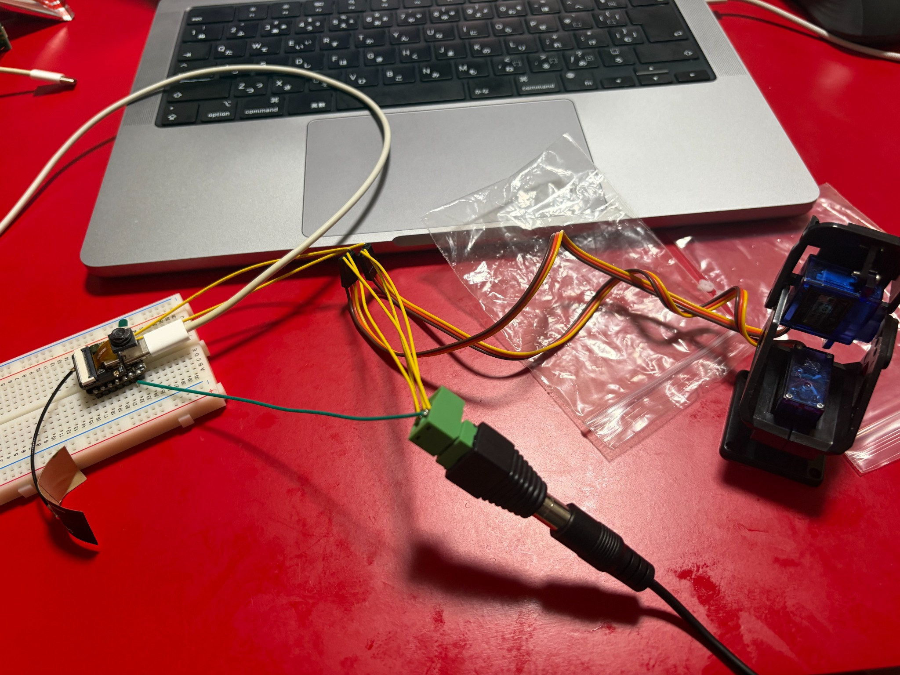
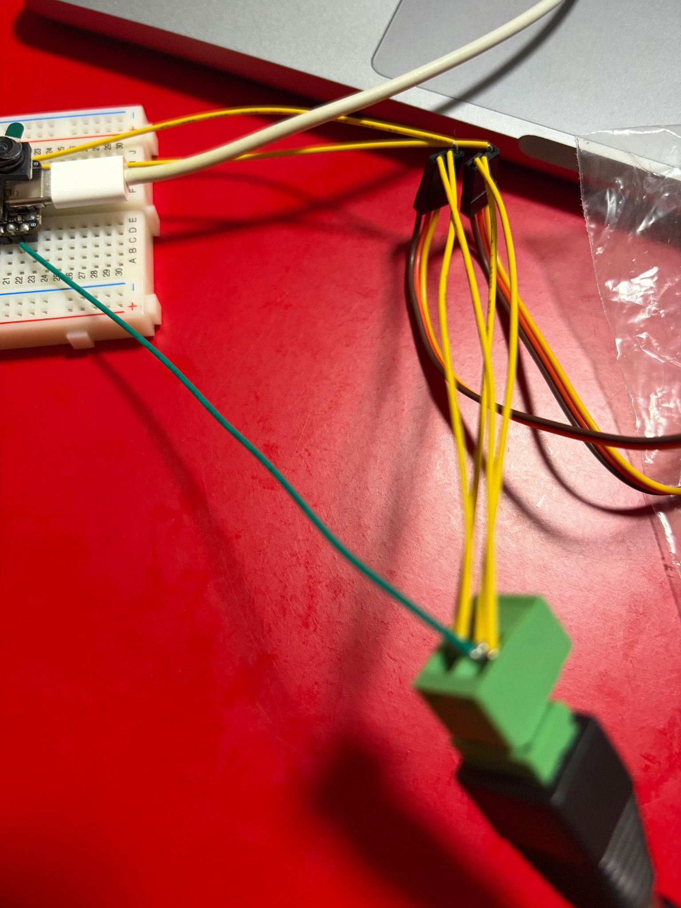
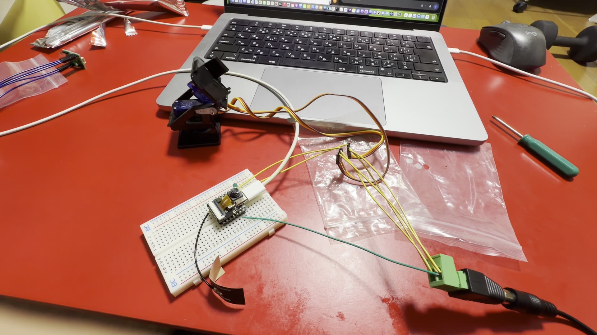
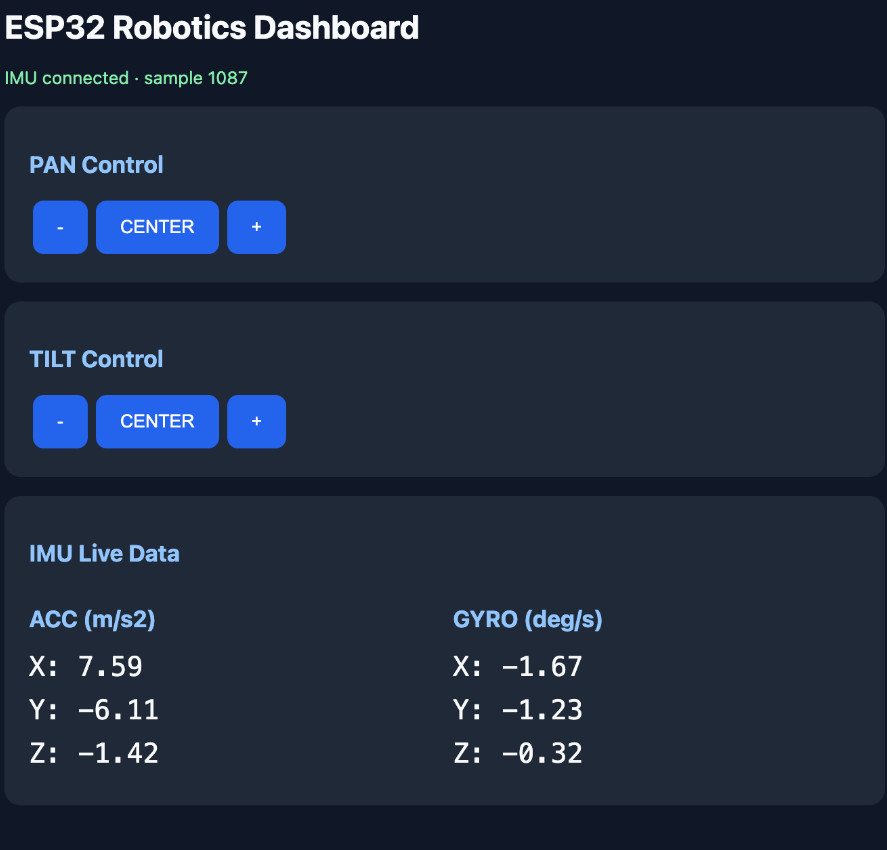

# Experiment 16 — Integrated ESP32-S3 Pan-Tilt Robotics System

**Date:** 2026-10-24 to 2026-10-27

**Status:** **Completed — 2026-10-27**

**Development environment:** ESP-IDF v6.1, C, Seeed Studio XIAO ESP32S3 Sense, Mac

## Objective

Build and verify an integrated embedded robotics prototype with two separately actuated servo axes, an LSM6DSV16X six-axis inertial sensor, an SSD1306-compatible OLED, and direct Wi-Fi browser control. Transfer live acceleration and angular-rate measurements to both the OLED and a browser dashboard, then verify simultaneous operation without servo binding or wireless interruption.

The goal was **integration and observable functionality**, not calibrated servo positioning, inertial navigation, closed-loop motor control, or an endurance qualification. The hardware and firmware milestones were completed on 2026-10-27.

## Background and system architecture

The firmware uses ESP-IDF rather than Arduino abstractions. Components include the LEDC PWM peripheral, the ESP-IDF I²C master driver, Wi-Fi SoftAP, the ESP HTTP server, and a FreeRTOS Queue containing the latest six-axis sensor sample.

```text
Mac browser
    | Wi-Fi to ESP32-PANTILT
    | HTTP routes: /dashboard, /api/imu, /pan/*, /tilt/*
    v
ESP32-S3 / ESP-IDF + C
    +--- LEDC 50 Hz PWM, 14-bit
    |       +-- GPIO3 / D2 --> SG90 PAN
    |       +-- GPIO4 / D3 --> SG90 TILT
    |
    +--- shared I2C (100 kHz)
    |       +-- GPIO5 / D4 SDA -- LSM6DSV16X (0x6A)
    |       +-- GPIO6 / D5 SCL -- SSD1306 OLED (0x3C)
    |
    +--- FreeRTOS single-item telemetry queue
            +-- /api/imu JSON --> browser live values
```

The servo supply is independent of the USB-powered XIAO; their grounds are common. I²C peripherals use the 3.3 V sensor rail.

## Equipment

- Seeed Studio XIAO ESP32S3 Sense and external Wi-Fi antenna
- Two SG90 servos with two-axis pan-tilt bracket
- External nominal 5 V servo power supply and DC input connector
- Akizuki AE-LSM6DSV16X six-axis IMU, LSM6DSV16X sensor
- SSD1306-compatible monochrome OLED, 0.96 in, 128 × 64
- Breadboard, jumper wires, servo extensions
- Mac computer with ESP-IDF v6.1, USB connection, terminal, Chrome

**Actual servo lead color identification for this hardware:** brown = ground, orange = external +5 V, yellow = PWM signal. These colors differ from the common red-power/orange-signal SG90 convention. Do not infer wire function from generic online color charts when rebuilding this device.

## Circuit and connections

| Connection | MCU pin or source | Destination |
| --- | --- | --- |
| PAN PWM | XIAO D2 / GPIO3 | Lower SG90, yellow signal wire |
| TILT PWM | XIAO D3 / GPIO4 | Upper SG90, yellow signal wire |
| Servo external supply | External +5 V | Both SG90 orange power wires |
| Servo ground | External supply GND | Both SG90 brown wires |
| Common ground | XIAO GND | External servo supply GND |
| I²C SDA | XIAO D4 / GPIO5 | IMU SDA and OLED SDA |
| I²C SCL | XIAO D5 / GPIO6 | IMU SCL and OLED clock input |
| Sensor supply | XIAO 3V3 | IMU and OLED 3.3 V inputs |
| IMU address selection | GND | IMU SA0, giving address 0x6A |

**Do not connect external +5 V to the XIAO 3V3 rail or 3.3 V GPIO.** The later shared-bus test operated without newly inserted external 10 kΩ pull-up resistors; its effective pull-up resistance was not measured, so that observation is not a general recommendation to omit required I²C pull-ups.

### Hardware photographs







These photographs document physical construction. They are not measurements of servo torque, absolute angular position, or electrical current.

## Reference, predictions, and configured values

- Servo PWM nominal frequency: **50 Hz**, configured via LEDC; the pulse repetition rate was not independently measured on an oscilloscope.
- LEDC duty resolution: **14 bits**, configured in software.
- Pulse-width center: **1500 µs**.
- Current tested control range: **1450–1550 µs**, in increments of **10 µs** in the browser control implementation.
- IMU I²C address: expected `0x6A`; expected identity register `WHO_AM_I (0x0F) = 0x70`.
- OLED I²C address: `0x3C` for the actually tested module.
- Static accelerometer vector magnitude should be near approximately 9.81 m/s² under the sensor's conversion assumptions, subject to orientation, motion, and calibration error.

The **1450–1550 µs** interval was an observed safe operating interval in this mounted configuration, *not* a measurement of maximum possible safe travel, shaft position, or torque.

## Chronological experimental procedure and results

### 16-1 — Dual-servo PWM control in ESP-IDF and C

Configured the LEDC timer at 50 Hz, 14-bit resolution, and separate channels for GPIO3/PAN and GPIO4/TILT. Both SG90 motors responded to PWM commands.

### 16-2 — Mechanical pan-tilt assembly

Mounted the two SG90 servos in the two-axis bracket. The lower assembly controls horizontal PAN; the upper assembly controls vertical TILT. The physical assembly was observed moving on both axes.

### 16-3 — Mechanical interference, heating, and safe pulse interval

An early TILT test failed: the motor did not move as expected and became abnormally warm. Inspection found that the servo's initial position and the bracket's mechanical travel did not align. After repositioning the mount and restricting the commanded pulses, the upper axis moved properly and the abnormal heating stopped during subsequent observed tests.

**Corrective setup:** use 1500 µs center, with a restricted 1450–1550 µs command interval for both axes. Mechanical safety must be checked when physical mounting or hardware changes. This is not a measured global safe-limit specification.

### 16-4 — Local Wi-Fi access point and browser servo control (2026-10-25)

Implemented SoftAP on the XIAO ESP32S3 Sense and started an HTTP server. The Mac connected directly to the ESP32 wireless network, then independently controlled both servo axes through browser links.

```text
SoftAP SSID: ESP32-PANTILT
ESP32 local address: 192.168.4.1
URL: http://192.168.4.1/
```

Control endpoints:

```text
/
/pan/minus
/pan/center
/pan/plus
/tilt/minus
/tilt/center
/tilt/plus
```

The temporary SoftAP password is not reproduced in this public record. Software configuration should accept a private value or a clearly non-secret development placeholder.

### 16-5A — I²C device probe

Used the ESP-IDF I²C master driver to probe bus addresses. With the OLED connected and the IMU disconnected, `0x3C` acknowledged, while `0x3D` and `0x6A` did not. The negative `0x6A` result is appropriate for that specific disconnected state and was not interpreted as an IMU failure.

### 16-5B — Direct SSD1306 OLED text output

Initialized the SSD1306-compatible OLED using I²C commands and transmitted bitmap/text data from C code. The display visibly rendered `HELLO!` without the Arduino Adafruit display library.

### 16-5C — Shared I²C wiring and probing

Connected OLED and IMU in parallel on GPIO5/SDA and GPIO6/SCL. The bus probe acknowledged both `0x3C` (OLED) and `0x6A` (IMU); the OLED continued displaying `HELLO!` with both connected. No new external 10 kΩ pull-ups were added during this test; pull-up impedance was not characterized.

### 16-5D — Single-bus driver integration

Created one I²C master bus, registered the IMU and OLED as distinct device handles, and completed IMU identification and OLED command transmission on the same bus.

Retained serial log:

```text
SHARED_I2C: Shared I2C bus initialized
SHARED_I2C: WHO_AM_I = 0x70
SHARED_I2C: LSM6DSV16X confirmed!
SHARED_I2C: OLED HELLO sent
SHARED_I2C: Shared I2C test finished
```

### 16-5E — Real-time six-axis sensor acquisition and OLED display

Configured the LSM6DSV16X sensor and read **12 bytes** starting at register `0x22`, corresponding to signed 16-bit gyroscope XYZ values followed by accelerometer XYZ values. The code converted raw values using these selected scales:

```c
#define ACC_SCALE  0.00059820565f  // m/s^2 per raw count
#define GYRO_SCALE 0.00875f        // deg/s per raw count
```

These are **software conversion assumptions**, not independent calibration measurements. The OLED displayed acceleration in m/s² and angular rate in deg/s, and the user verified that the displayed values changed in real time when moving the IMU.

Representative retained serial values:

```text
ACC: 5.97 -6.17 4.53 m/s2
GYRO: 0.06 -0.14 0.36 deg/s
```

The rounded stationary acceleration vector magnitude is approximately **9.71 m/s²** (calculated from the reported sample, not an independent measurement). It is a plausible gravity-dominated reading; it does not establish calibrated accuracy or zero gyroscope bias.

### 16-5F — Browser robotics dashboard (2026-10-27)

Added a one-item FreeRTOS Queue for the latest six-axis sample, a JSON endpoint at `/api/imu`, and a browser dashboard at `/dashboard`. The page retrieves live data periodically and exposes buttons for each servo axis. I²C acquisition and OLED updating continue in the firmware alongside the separate HTTP server task.

```text
http://192.168.4.1/api/imu
http://192.168.4.1/dashboard
```

The user opened the live dashboard from Chrome on a Mac. The screenshot included `IMU connected · sample 1087`, both servo control groups, and these **observed displayed values**:

| Channel | X | Y | Z | Units |
| --- | ---: | ---: | ---: | --- |
| Accelerometer | 7.59 | -6.11 | -1.42 | m/s² |
| Gyroscope | -1.67 | -1.23 | -0.32 | deg/s |



Bench testing further confirmed that clicking PAN/TILT buttons produced actual movement of the corresponding physical servos. The values above are observations from a single screenshot, not a calibrated series or fixed orientation.

### 16-5G — Concurrent operation and mechanical safety (2026-10-27)

The recorded bench session confirmed all four checks:

1. OLED and browser telemetry continued updating during PAN/TILT operations.
2. Wi-Fi stayed connected during repeated control.
3. The servos did not visibly bind against mechanical stops or exhibit abnormal heating in the test.
4. The currently configured PWM interval operated successfully.

No duration, sample-size estimate, oscilloscope waveform, supply current, dynamic acceleration accuracy, or maximum shaft travel was retained. These were functional bench checks, not a formal reliability certification.

### 16-5H — Basic code modularization (2026-10-27)

Moved the LEDC-specific servo implementation out of `hello_world_main.c` into `servo.c` and `servo.h`. The application now calls public functions `servos_init()` and `servo_set_pulse()` with logical PAN and TILT axes. The user rebuilt/flashed the refactored project and confirmed that the existing system worked.

No further source-file splitting is a completion requirement for this experiment.

## Published firmware source

The actual last-tested ESP-IDF project source is available in [`firmware/esp32s3-experiment16/`](../firmware/esp32s3-experiment16/). It includes the post-test `servo.c`/`servo.h` separation, I²C IMU/OLED integration, HTTP routes, telemetry queue, and browser dashboard. The sanitized repository copy was also configured for `esp32s3` and built successfully with ESP-IDF v6.1 on 2026-10-27; it was not reflashed as part of repository publication.

The public copy excludes generated build output, local `sdkconfig` files, backups, local filesystem paths, and private credentials. Its SoftAP password is a clearly labeled non-secret development placeholder that must be changed before deployment.

## Troubleshooting record

| Symptom | Investigation and correction | Qualification |
| --- | --- | --- |
| TILT servo would not turn and became abnormally hot | Mechanical starting alignment and travel interfered; repositioned mount and constrained pulses | Resolved during later tested interval; stop immediately if heating/binding recurs |
| LEDC reported `Fade service not installed` | Replaced `ledc_set_duty_and_update()` with `ledc_set_duty()` followed by `ledc_update_duty()` | Successfully used in the working PWM control |
| `undefined reference to i2c_probe_run` | Ensured implementation source was included in component build and function was available to the caller | Linking issue, not electrical sensor failure |
| `driver/gpio.h: No such file or directory` | Added `esp_driver_gpio` to `PRIV_REQUIRES` in the component `CMakeLists.txt` | ESP-IDF component dependency |
| `implicit declaration of function ESP_RETURN_ON_ERROR` | Added `#include "esp_check.h"` | Missing macro definition during C compilation |
| USB flashing reported `No serial data received` | Used the appropriate port, BOOT/RESET recovery and USB reconnection | Exact occurrence and sequence may vary |
| Historical I²C timeouts / no device | Earlier D4/GPIO5 to D5/GPIO6 solder bridge diagnosed by continuity check and removed | See [Experiment 12](12-imu-acceleration-gyroscope.md) for the original diagnosis |

## What was verified and what was not

**Verified:** working dual-axis commands; actual two-axis movement; I²C ACKs from 0x3C and 0x6A; correct IMU identity 0x70; displayed OLED text and live sensor values; HTTP JSON data; browser six-axis dashboard and clickable physical control; concurrent operation under the observed bench conditions; firmware continued working after basic servo-module separation.

**Not independently measured:** true servo shaft angles, PWM timing with test equipment, current under load, motor torque, full stable travel limits, temperature over a quantified time span, I²C pull-up resistance, sensor noise, accelerometer/gyro calibration, network latency, or long-duration reliability. No automated closed-loop feedback or camera tracking was built in this experiment.

## Lessons learned

- Separate physically high-current servo power from the 3.3 V sensor supply, but use a common reference ground.
- Validate the actual wiring colors on purchased hardware; appearance alone can be misleading.
- Narrow software pulse limits and alignment checks reduce the chance of mechanical stalls, but they do not replace electrical protection.
- Devices with distinct I²C addresses can operate on a shared SDA/SCL pair using one bus driver and separate device handles.
- A thread-safe transfer of the latest sample into an HTTP endpoint allows simultaneous acquisition and browser visualization without competing for the I²C bus.
- Firmware changes are easier to validate when the last working build is backed up and each refactoring step is tested.

## Conclusion and future work

**Experiment 16 completed on 2026-10-27.** The system combined C firmware, dual-axis servos, inertial sensing, an OLED, Wi-Fi SoftAP, an HTTP server, JSON telemetry, and a browser control interface. The completion criterion was verified functional integration, not production-level robustness or a calibrated robotics controller.

Future work is outside Experiment 16: MOSFETs and power electronics, motor drivers, encoders, feedback/PID control, camera processing, and more capable robotic manipulators.
