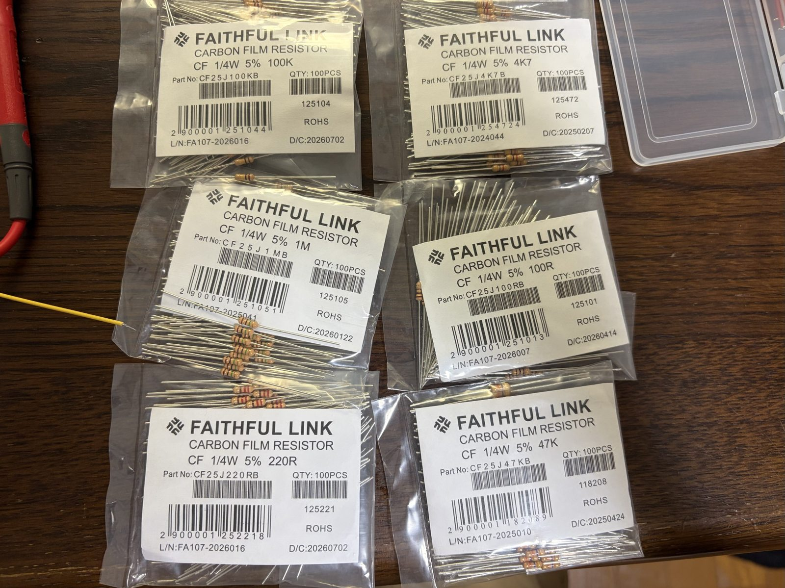
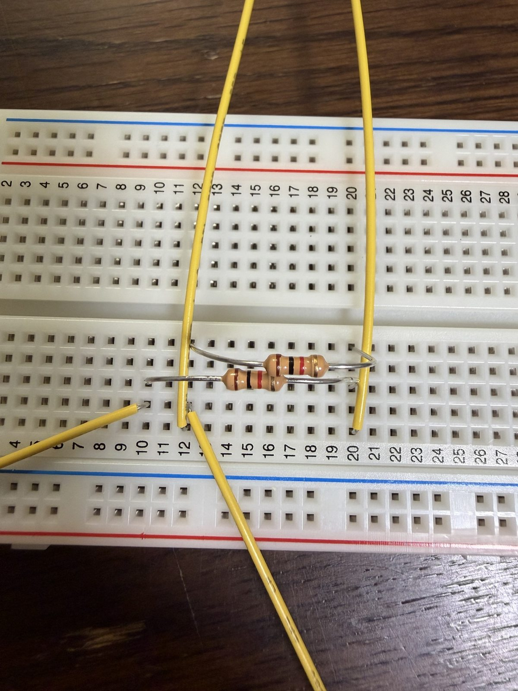

# Chapter 1 — The Circuit Abstraction

**Primary textbook:** Anant Agarwal and Jeffrey H. Lang, *Foundations of Analog and Digital Electronic Circuits* (Morgan Kaufmann, 2005), Chapter 1.  
**Educational context:** The textbook was developed for the authors' MIT **6.002 — Circuits and Electronics** course. This is my independent study notebook, **not** an MIT affiliation or course-completion record.  
**Study status:** **§§1.1–1.7 studied; §1.8 introduction reached; §1.8.1 onward not yet studied.**  
**Writing:** Original English notes based on personal reading, derivations, and hands-on experiments. No textbook figures or passages are reproduced.

## Reading map and detailed notes

| Textbook section | Main ideas | My notes | Progress |
| --- | --- | --- | --- |
| §1.1 — The Power of Abstraction | Hierarchies of models; discretization | [Detailed notes](chapter-01/01-power-of-abstraction.md) | Studied |
| §1.2 — The Lumped Circuit Abstraction | Terminals, black boxes, ideal wires, circuits | [Detailed notes](chapter-01/02-lumped-circuit-abstraction.md) | Studied |
| §1.3 — The Lumped Matter Discipline | Three fundamental constraints; finite signal speed | [Detailed notes](chapter-01/03-lumped-matter-discipline.md) | Studied |
| §1.4 — Limitations of the Lumped Circuit Abstraction | Propagation, parasitics, distributed models | [Detailed notes](chapter-01/04-limitations.md) | Studied |
| §1.5 — Practical Two-Terminal Elements | Batteries, material resistance, power, sign convention | [Detailed notes](chapter-01/05-practical-two-terminal-elements.md) | Studied |
| §1.5.1 — Batteries | Voltage, energy, capacity, series/parallel cells | [Within §1.5](chapter-01/05-practical-two-terminal-elements.md#151--batteries) | Studied |
| §1.5.2 — Linear Resistors | Ohm's law, resistivity, geometry, sheet resistance | [Within §1.5](chapter-01/05-practical-two-terminal-elements.md#152--linear-resistors) | Studied |
| §1.5.3 — Associated Variables Convention | Signs, absorbed/delivered power, energy | [Within §1.5](chapter-01/05-practical-two-terminal-elements.md#153--associated-variables-convention) | Studied |
| §1.6 — Ideal Two-Terminal Elements | Ideal source, conductor, resistor, element laws | [Detailed notes](chapter-01/06-ideal-two-terminal-elements.md) | Studied |
| §1.6.1 — Ideal Voltage Sources, Wires, and Resistors | Independent sources, conductance | [Within §1.6](chapter-01/06-ideal-two-terminal-elements.md#161--ideal-voltage-sources-wires-and-resistors) | Studied |
| §1.6.2 — Element Laws | $v$–$i$ characteristics of primitive elements | [Within §1.6](chapter-01/06-ideal-two-terminal-elements.md#162--element-laws) | Studied |
| §1.6.3 — The Current Source—Another Ideal Two-Terminal Element | Current source and ideal limits | [Within §1.6](chapter-01/06-ideal-two-terminal-elements.md#163--the-current-source-another-ideal-two-terminal-element) | Studied |
| §1.7 — Modeling Physical Elements | Source resistance, physical models, validity | [Detailed notes](chapter-01/07-modeling-physical-elements.md) | Studied |
| §1.8 — Signal Representation | Voltage/current representing energy and information | [Introduction notes](chapter-01/08-signal-representation-introduction.md) | Introduction only |
| §1.8.1 — Analog Signals | — | Not yet written | **Next** |
| §1.8.2 — Digital Signals / Value Discretization | — | Not yet written | Not started |
| §1.9 — Summary and Exercises | — | Not yet written | Not started |

The status reflects my *reading progress*, not a claim that every exercise has been solved or every concept fully mastered.

## Concept map

```text
Why abstract? (§1.1)
       │
       ▼
Describe devices via terminals (§1.2)
       │
       ▼
Specify when terminal variables are valid (§1.3)
       │
       ├──→ Recognize invalid regimes (§1.4)
       │
       ▼
Study physical resistor/battery behavior (§1.5)
       │
       ▼
Define ideal building blocks + element laws (§1.6)
       │
       ▼
Build useful models of real devices (§1.7)
       │
       ▼
View voltage/current as signals (§1.8 intro)
       │
       ▼
Next: Analog Signals (§1.8.1)
```

## Important equations from what I studied

| Concept | Relationship | Conditions / interpretation |
| --- | --- | --- |
| Charge flow | $i=dq/dt$ | Current is rate of charge transfer |
| Ohmic resistor | $v=iR$ | Element law with matched reference directions |
| Material resistance | $R=\rho\ell/A$ | Uniform geometry/material; applicable conditions |
| Planar sheet resistance | $R=R_{\square}\ell/w$, $R_{\square}=\rho/h$ | Same film thickness and material |
| Conductance | $G=1/R$, $i=Gv$ | Ideal linear resistor |
| Absorbed power | $p=vi$ | **Associated variables convention** |
| Resistor power | $p=i^2R=v^2/R$ | $R>0$ |
| Energy | $w=\int p(t)dt$ | Signed according to power convention |
| Ideal voltage source | $v=V_s$ | Prescribed voltage |
| Ideal current source | $i=I_s$ | Prescribed current |
| Ideal wire | $v=0$ | Arbitrary finite current in valid network |
| Ideal open | $i=0$ | Arbitrary finite voltage in valid network |
| Loaded physical source | $V_t=V_0-I_{\mathrm{out}}r$ | Series internal resistance; current **out of** positive terminal |
| Propagation check | $t_{\mathrm{prop}}\ll T_{\mathrm{signal}}$ | Part of the lumped-matter discipline |

These expressions are a **reference sheet**; derivations, limits, and examples appear in the section notes linked above.

## Connecting textbook study to hands-on experiments

The lab exercises do not follow the textbook's chapter sequence exactly. For example, I measured **KCL**, **KVL**, and voltage division *before* formally reading the textbook's full Chapter 2 treatment of network analysis. This is a conscious distinction between practical exploration and reading completion.

| Laboratory activity | Supporting ideas from Chapter 1 | Experiment log |
| --- | --- | --- |
| Resistor/voltage/current measurement | Element laws, terminal quantities, idealized models | [01 — Basic measurements](../../experiments/01-measurements.md) |
| Equal/unequal series resistors | Ohm's law, voltages, power, reference directions | [02 — Series circuits](../../experiments/02-series-circuits.md) |
| Two parallel resistors and branch currents | Conductance, node connectivity, model testing | [03 — Parallel circuits](../../experiments/03-parallel-circuits.md) |





[All 29 lab photos](../../photos/README.md)

## How I want to continue these notes

For each new section:

1. Read the actual textbook section before marking it studied.
2. Explain definitions and assumptions in my own words.
3. Derive or interpret the key equations with correct units and signs.
4. Include an original numerical example where useful.
5. Relate it to a **measured** experiment only when that experiment was actually performed.
6. Clearly separate **observed values**, **theoretical predictions**, and **questions for future investigation**.

**Next reading:** §1.8.1, **Analog Signals**. Notes for this subsection should be added *after* studying it.

[← Repository README](../../README.md)
